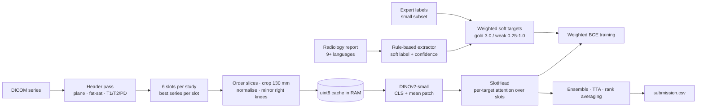

# Knee MRI Abnormality Detection (RSNA × Kaggle)

[](../../actions/workflows/tests.yml)

Multi-label detection of 12 knee abnormalities from MRI studies, built for the Kaggle competition
[RSNA Knee Abnormality Detection](https://www.kaggle.com/competitions/rsna-knee-abnormality-detection).

Each study contains several DICOM series (different planes and sequences) plus a free-text radiology report.
Only a small subset of the training studies has expert labels, so the pipeline first **derives weak labels
from the reports**, then trains an **image model** that never sees the report at test time.

---

## Pipeline at a glance



More detail on every stage and why it was built that way: [`docs/pipeline.md`](docs/pipeline.md) and
[`docs/design-decisions.md`](docs/design-decisions.md).

---

## Targets

| Ligaments & menisci | Osteoarthritis | Joint & bone |
|---|---|---|
| ACL | Medial OA | Effusion |
| MCL | Lateral OA | Synovitis |
| Medial Meniscus | PF (patellofemoral) OA | Baker's cyst |
| Lateral Meniscus | | Contusion |
| | | Fracture |

---

## Approach

### 1. Weak labels from radiology reports
The reports are written in at least nine languages (English, Spanish, French, Dutch, German, Turkish,
Croatian/Serbian, Greek and Bulgarian). A rule-based extractor ([`src/knee_mri/report_labels.py`](src/knee_mri/report_labels.py))
turns each report into a soft label and a confidence score per target:

- **Text normalisation:** Unicode folding, removal of diacritics, unwrapping of hard line breaks, and splitting into clauses.
- **Anatomy matching:** multilingual phrase lists, plus a fallback that matches a stem (e.g. *menisc-*) near a side word (*medial*, *lateral*…).
- **Negation:** pre- and post-negation within a character window (Turkish places negation after the finding), cut off by contrast words such as *but / pero / aber*.
- **Uncertainty and normality:** *possible, suspected, intact, unremarkable…* lower or flip the label.
- **Severity and grade:** *mild / moderate / severe* and grades written as numbers or Roman numerals scale the score.
- **OA localisation:** evidence is split into strong, moderate and weak tiers and assigned to the medial, lateral or patellofemoral compartment. A global finding such as "tricompartmental OA" is inherited only by compartments that are not described separately.
- **Decoys:** *microfracture* (a procedure) is not a fracture; a *meniscal cyst* is not a Baker's cyst.

During training, expert-labelled studies get loss weight 3.0. Report-derived labels get `0.25 + 0.75 × confidence`.

### 2. Series selection and preprocessing (DICOM)
- Each series is classified from its DICOM headers (fat-suppressed or not; T1, T2, PD or GRE). The best series is picked for each of **6 slots**, e.g. `SAG_FLUID_FS`, `COR_FLUID_FS`, `AX_FLUID_FS`, `COR_T1`.
- Slices are ordered by patient geometry (`ImagePositionPatient` projected onto the slice normal). Slices are sampled from the central 20–80 % of the stack.
- Images are cropped to a fixed 130 mm field of view using `PixelSpacing`, then percentile-normalised and resized.
- **Laterality** is read from the DICOM tag, with a fallback to scanner geometry. Right knees are mirrored so that "medial" is always on the same side of the image.
- Everything is decoded once into a uint8 cache sized against the available RAM.

### 3. Model
- **Backbone:** DINOv2-small (ViT). The last 6 transformer blocks are fine-tuned (≈10.7M trainable parameters).
- **2.5D input:** three neighbouring slices are fed as the three image channels.
- **Per-slot features:** the CLS token is concatenated with the mean of the patch tokens.
- **SlotHead:** each target has a learned query that attends over the 6 slots. Missing series are masked out. An optional anatomical prior biases each target towards the planes a radiologist would use (e.g. sagittal for the ACL).

### 4. Training
- AdamW with separate learning rates for the backbone (8e-6) and the head (1e-3), OneCycle schedule and mixed precision.
- Augmentation: random rotation, scaling, shifting and intensity changes.
- **Leakage-safe holdout:** studies are split by a hash of the report text, so duplicated reports cannot end up in both train and validation.
- Metric: macro ROC-AUC across the 12 targets, reported both on the weak-label holdout and on the expert-labelled studies inside it.

### 5. Inference
- Ensemble members are loaded from a manifest. Each checkpoint's output is checked against a stored **fingerprint**, which catches silent mismatches in preprocessing or architecture.
- Test-time augmentation uses sliding windows over slices, with **per-target pooling**: `max` for focal findings such as fractures, `mean` for diffuse ones.
- Members are combined by rank averaging, with a time-budget scheduler that runs across both GPUs.
- A valid fallback submission is written first, and every submission is validated against the competition format.

---

## Results

| Setup | Private leaderboard (macro ROC-AUC) |
|---|---|
| Final submission from this notebook | **0.785** |

The score comes from Kaggle's scoring run on the hidden test set. Kaggle does not show the logs of that run.

> The outputs saved in the notebook come from a **smoke run** (60 studies, 1 epoch, 3 public test studies),
> which Kaggle runs automatically when a version is saved. They show that the pipeline runs end to end,
> not how well the model performs.

<details>
<summary>Smoke-run output (3 test studies)</summary>

| Target | Study …276191 | Study …991776 | Study …591402 |
|---|---|---|---|
| ACL | 0.333 | 1.000 | 0.667 |
| MCL | 0.667 | 0.333 | 1.000 |
| Medial Meniscus | 0.333 | 1.000 | 0.667 |
| Lateral Meniscus | 0.333 | 0.667 | 1.000 |
| Medial OA | 0.333 | 0.667 | 1.000 |
| Lateral OA | 0.333 | 0.667 | 1.000 |
| PF OA | 1.000 | 0.333 | 0.667 |
| Effusion | 1.000 | 0.667 | 0.333 |
| Synovitis | 0.333 | 0.667 | 1.000 |
| Baker's | 0.333 | 0.667 | 1.000 |
| Contusion | 0.667 | 1.000 | 0.333 |
| Fracture | 0.667 | 1.000 | 0.333 |

Values are percentile ranks (`rank(pct=True)`), not probabilities. With only 3 studies the possible ranks are 1/3, 2/3 and 1.

</details>

---

## Repository structure

```
.
├── knee-mri-abnormality-detection.ipynb   # main notebook (runs on Kaggle)
├── src/knee_mri/
│   └── report_labels.py                   # report -> weak labels, stdlib only, importable
├── scripts/
│   ├── build_report_labels.py             # write the weak-label table for train.csv
│   └── evaluate_labels_against_gold.py    # AUC of the weak labels vs. the expert labels
├── tests/
│   └── test_report_labels.py              # behavioural tests for the extractor rules
├── docs/
│   ├── pipeline.md                        # stage-by-stage walkthrough
│   └── design-decisions.md                # what was chosen, the alternatives, and why
├── .github/workflows/tests.yml            # runs the tests on every push
├── requirements.txt
└── requirements-dev.txt
```

## How to run

**On Kaggle (recommended).** Open the notebook on Kaggle, attach the competition data and the
`facebook/dinov2-small` model, and run it on a GPU (the full run used 2× Tesla T4).

**Locally (label extractor and tests).** These need no GPU and no images:
```bash
pip install -r requirements-dev.txt
pytest                                    # runs the extractor tests

pip install kaggle                        # needs a Kaggle API key and accepted competition rules
kaggle competitions download -c rsna-knee-abnormality-detection
unzip rsna-knee-abnormality-detection.zip -d data/
python scripts/build_report_labels.py     # -> data/derived/report_labels_v2.csv
python scripts/evaluate_labels_against_gold.py
```
The competition data cannot be redistributed, so it is not part of this repository.

**Full notebook locally.** The notebook looks for the data in `/kaggle/input/...` first and falls back to `./data`.
The DINOv2 weights are found automatically on Kaggle only; locally, download `facebook/dinov2-small` from
Hugging Face and pass its path to `build_model(source=...)`.

## Limitations and next steps
- The report-derived labels are noisy, especially for Synovitis, which is rarely stated explicitly.
- The best epoch is chosen on the weak-label holdout. Selecting on the expert-labelled subset would be more faithful but is small and noisy.
- Only 3 slices per slot are cached because of memory limits. A 3D or slice-sequence model would use more of each volume.
- The labeller could be replaced by an LLM or a fine-tuned multilingual text model, with the regex rules kept as a baseline.
- The notebook still contains code paths from earlier versions (legacy ensemble branches, unused imports). Moving the pipeline into `src/` modules would make it easier to test and maintain.

## Acknowledgements
- RSNA and Kaggle for the dataset and the competition.
- [Bend the Knee to the Dinosaurs](https://www.kaggle.com/code/mattiaangeli/bend-the-knee-to-the-dinosaurs) by mattiaangeli, a public Kaggle notebook this work builds on.
- [DINOv2](https://github.com/facebookresearch/dinov2) (Meta AI).
